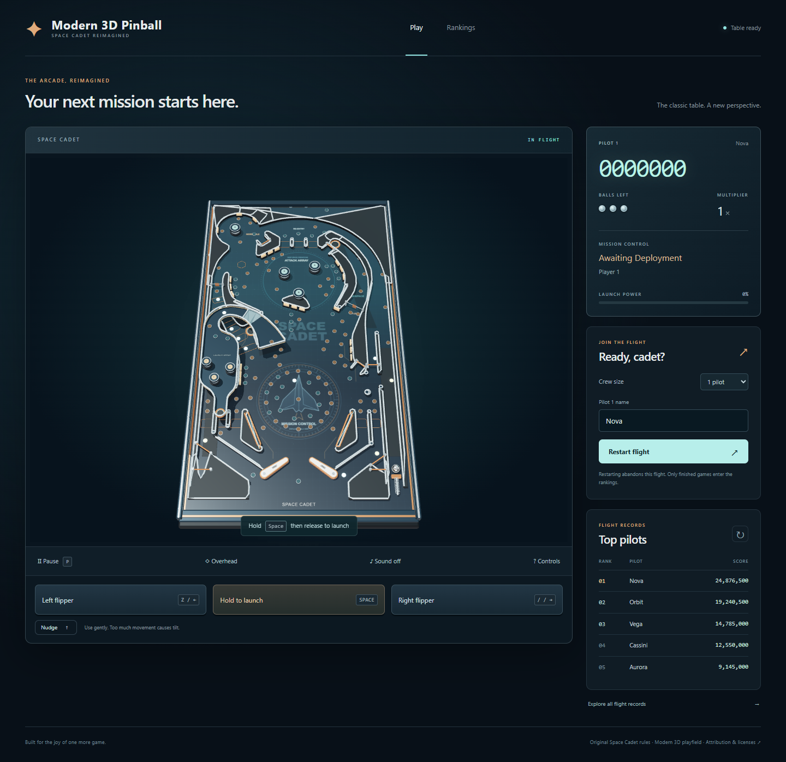
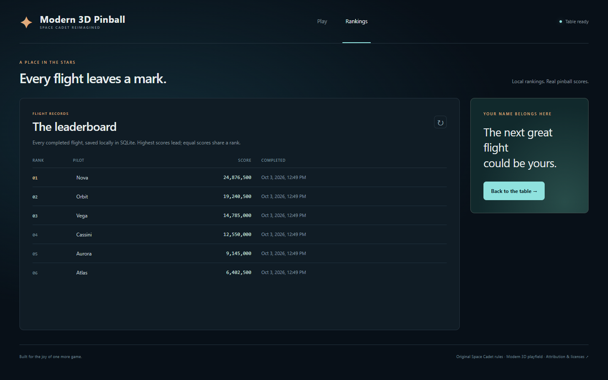
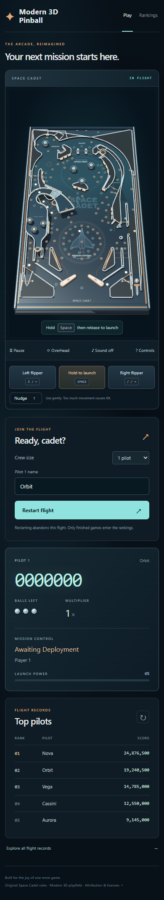

# Modern 3D Pinball

A playable React application using the preserved Space Cadet JavaScript engine,
with a Python FastAPI service and persistent SQLite rankings. The frontend owns
the simulation, Three.js table, keyboard/touch input, sound, and game lifecycle.
Python serves the original readable table data, creates game sessions, and saves
the final scores when all players finish their game.

The adapted Space Cadet engine is preserved in `frontend/src/pinball/`. It contains
JavaScript rather than Python; the Python backend adapts its table data and adds
the ranking service rather than duplicating the physics in another language.

Runtime table data lives in `assets/table.json` at the repository root. The backend
serves this standalone copy through `/api/table`; running the app does not require
reading assets from `original-project/`.

## Screenshots

Desktop gameplay:



Persistent score rankings:



Mobile gameplay with touch controls:



These screenshots show the running application. Ranking entries are sample
scores created in an isolated temporary database for the captures.
After setup, regenerate the images with `python tools/capture_screenshots.py`.

## Quick start

Windows:

```powershell
.\setup.bat
.\run.bat
```

Linux/macOS:

```bash
bash setup.sh
bash run.sh
```

Install Python 3.10+, Node.js 20.19+, and npm 10+ (Node.js 24 is used in CI). Setup creates
and reuses this repository's `.venv`, installs the Python dependencies, and uses
the npm lockfiles to install frontend and browser-test dependencies. It creates
`.env` from `.env.example` only if `.env` does not already exist. No activation
command is needed, even if another Python environment is active.

Open the frontend URL printed by the runner, enter player names, and start a
game. The table supports one to four players taking turns. Finish all balls to
save the scores and receive your leaderboard positions. Closing the browser or
restarting a game abandons that game without publishing a partial score.

The default frontend and backend ports are `3010` and `3020`, from
`port_mapping.json`. The runner initializes missing per-user settings and checks
both ports before launch and advances to the next available port when needed.
It prints the actual URLs selected for the session. Press Ctrl+C in the runner
terminal to stop both services and their child processes.

## LAN access

The development runner and portable Release build bind both services to
`0.0.0.0` by default. Open a printed `LAN` frontend URL on another device on the
same network. All browser `/api` requests go through the frontend's proxy, so
the frontend needs no machine-specific IP address or rebuild when ports change.
Startup lists detected IPv4 interfaces, including virtual adapters; choose the
adapter connected to the other device. If access is blocked, allow Python or
`server.exe` through Windows Firewall on your private network and check that
your Wi-Fi network allows devices to communicate.

Use `run.bat --host 127.0.0.1` for local access, or `--host 192.168.1.10` to
bind a specific adapter. The portable Debug build defaults to `127.0.0.1`.
`--host` overrides `BACKEND_HOST`, which overrides the generated build profile.
Existing `.env` files are preserved; change an old `BACKEND_HOST=127.0.0.1`
to `0.0.0.0` if you want LAN access.

| Action | Keyboard |
| --- | --- |
| Left flipper | Z or Left arrow |
| Right flipper | Slash or Right arrow |
| Launch | Hold Space, then release |
| Nudge | X, period, or Up arrow |
| Pause/resume | P or Escape |
| New game | N or F2 |

On-screen hold/release buttons work on touch devices. Sound and camera controls
are available beside the table. Leaving the window pauses the game.

## Portable Windows builds

```powershell
.\build.bat
# Reuse installed build dependencies:
.\build.bat --skip-install
```

The builder uses the repository `.venv`, installs backend and PyInstaller build
dependencies, checks TypeScript, builds React, and produces:

```text
dist/
  Debug/                   Default bind address: 127.0.0.1
  Release/                 Default bind address: 0.0.0.0
    server.exe             Frontend and API server, with embedded Python
    public/                Built frontend and license attribution
    assets/table.json      Standalone runtime table data
    run.bat                Initializes settings before launching either service
    runtime.json           Default bind address
    port_mapping.json      Defaults copied from this project's root
```

Both profiles contain the same files. Copy the entire chosen folder to another
Windows machine; Python and Node.js are required only on the build machine.
Run `dist\Release\run.bat` for LAN access or `dist\Debug\run.bat` for local
access. Both launchers create `settings.json` as `{}` if absent, populate only
missing `frontend_port` and `backend_port` from their included mapping, then
read settings again before starting the two listeners. Unknown settings and
user-defined values are preserved.

```powershell
.\dist\Release\run.bat --frontend 4010 --backend 4020
```

`--frontend-port` and `--backend-port` are equivalent. Ports must be distinct
integers from 1 to 65535. Portable builds reserve exactly the selected ports and
report an error if either is busy. Optional `.env` files beside `server.exe`
support the same overrides as the source launcher. Rebuilding replaces generated
artifacts while preserving each distribution's `.env` and data files.

GitHub Actions runs checks and builds both Windows profiles on every push to
`main` (including merged pull requests), and can be started manually. Download
the Debug and Release ZIPs, with SHA-256 checksums, from the build run's
`3d-pinball-rebuild-windows-x64-<run_number>` artifact. Builds are available as
workflow artifacts; they are not automatically
published as GitHub Releases.

## Source production server

```powershell
.\run.bat --production
```

```bash
bash run.sh --production
```

This builds `frontend/dist/` and starts one FastAPI service that serves both the
built React app and `/api` on the backend port, with reload disabled. Vite's
development server is used only by the development runner. See the official
[Vite deployment guide](https://vite.dev/guide/static-deploy.html) for the build
output and [FastAPI static files guide](https://fastapi.tiangolo.com/tutorial/static-files/)
for serving static assets.

For a server with an existing build, set `PINBALL_STATIC_DIR=frontend/dist` and
run the virtual environment's Python with:

```bash
python -m uvicorn backend.app.main:app --host 127.0.0.1 --port 8000
```

Place a public deployment behind your HTTPS reverse proxy, and keep the database
on persistent local storage. Back up SQLite using its backup API or stop the
service before copying its database and WAL files. There is no login system:
names identify entries rather than verified accounts. Scores are reported by
the browser; validation and idempotent submissions prevent malformed or duplicate
records, but this is a casual leaderboard, not an authoritative anti-cheat service.

## Configuration

Windows stores settings at `%APPDATA%\3d-pinball-rebuild\settings.json`.
The `data_directory` defaults to `%TEMP%\3d-pinball-rebuild`; the folder is
created when needed and holds `pinball.db`. Development, Debug, and Release
share these settings and rankings for the current user. Edit settings and restart
to change ports or storage:

```json
{
  "frontend_port": 3010,
  "backend_port": 3020,
  "data_directory": "D:/PinballData"
}
```

Environment variables and `~` expand in folder paths. Relative folders resolve
beside `settings.json`. Invalid JSON, invalid folder values, or invalid saved
ports stop startup without replacing the file. The default temp directory may
be cleared by the operating system; choose a permanent folder for rankings you
want to retain. Existing `data/pinball.db` files are not moved automatically.
With the app stopped, copy the existing database into your chosen folder, or
set `PINBALL_DB_PATH` to its existing location.

On Linux/macOS the settings path is
`$XDG_CONFIG_HOME/3d-pinball-rebuild/settings.json`, defaulting to
`~/.config/3d-pinball-rebuild/settings.json`. Data defaults to
`$TEMP/3d-pinball-rebuild`, or that folder under the system temporary directory.

Command-line ports override environment variables, which override saved settings.
Terminal environment variables take precedence over `.env`. Port overrides
apply to the current launch and do not change saved settings. `port_mapping.json`
supplies missing settings only; changes to it do not overwrite existing ports.

| Variable | Default | Purpose |
| --- | --- | --- |
| `BACKEND_PORT` | Saved setting (initially `3020`) | Backend port override |
| `FRONTEND_PORT` | Saved setting (initially `3010`) | Frontend port override |
| `BACKEND_HOST` | Source/Release: `0.0.0.0`; Debug: `127.0.0.1` | Bind address for both services |
| `PINBALL_DB_PATH` | `data_directory/pinball.db` | Explicit database file override; relative to repository/distribution root |
| `CORS_ORIGINS` | Local frontend origins | Comma-separated permitted browser origins |
| `PINBALL_STATIC_DIR` | Unset | Serve a prebuilt frontend directory; set by production runner |
| `PINBALL_SESSION_TTL_SECONDS` | `86400` | Active-session lifetime; configurable from 60 seconds to seven days |

The development runner sets the Vite API proxy to the actual selected backend
port. To launch Vite separately, set `BACKEND_URL` to the Python service URL.
Local `.env` files, `.venv`, npm dependencies, build artifacts, and runtime
databases are ignored by Git. No external API keys are required.

## API

| Method | Path | Behavior |
| --- | --- | --- |
| `GET` | `/api/health` | Backend health check |
| `GET` | `/api/table` | Read the original table geometry and gameplay attributes |
| `POST` | `/api/games` | Start a session with `{"player_names":["Cadet"]}` |
| `POST` | `/api/games/{id}/complete` | Save `{"scores":[12000],"duration_ms":60000}` |
| `GET` | `/api/leaderboard?limit=10&offset=0` | Read scores, competition ranks, and total entry count |

Tied scores share a rank (for example 1, 1, 3), with deterministic ordering inside
a tie. SQLite transactions atomically save every player in a game. Retrying an
identical completed submission returns the existing result; changing its scores
returns a conflict. Rankings survive application restarts. Active sessions expire
after 24 hours by default; completed results remain available.

Interactive API documentation is available at the backend `/docs` URL.

## Tests and build

```powershell
.venv\Scripts\python.exe -m unittest discover -s backend\tests -v
.venv\Scripts\python.exe -m unittest discover -s tests -v
python tools/check_secrets.py
cd frontend
npm run typecheck
npm test
npm run build
cd ..\e2e
npm run typecheck
npm test
```

On Unix, use `.venv/bin/python` for the Python checks. The Playwright suite starts
FastAPI and Vite automatically and uses an isolated system-temp SQLite database,
then deletes it. It exercises gameplay controls, game-over submission, persistence,
retries, multiplayer, and mobile layout. Tests use Microsoft Edge locally on
Windows/Linux when available, and WebKit on macOS. For bundled Chromium instead,
run `npm run install:chromium` in `e2e` and set `PLAYWRIGHT_BROWSER=chromium`.
If another service uses the test ports, set `PINBALL_E2E_BACKEND_PORT` and
`PINBALL_E2E_FRONTEND_PORT` to distinct free ports (defaults: `8001` and `5174`).

On a fresh macOS checkout, install the WebKit browser once before running the
tests:

```bash
cd e2e
npm run install:webkit
```

## Project layout

```text
assets/                   Standalone runtime table data served by the backend
backend/app/              FastAPI routes, configuration, schemas, table adapter, SQLite store
backend/tests/            API, ranking, concurrency, and persistence checks
frontend/src/             React shell, API client, game lifecycle and controls
frontend/src/pinball/      Adapted engine, Three.js renderer, and synthesized sound
e2e/                      Playwright checks with an isolated temporary database
tests/                    Cross-platform setup and process orchestration checks
data/                     Legacy ranking database folder (database ignored)
tools/check_secrets.py    Credential pattern audit that prints locations only
setup.py / setup.*        Project virtual environment and dependency installation
run.py / run.*            Development and built-application runners
build.py / build.bat      Portable Windows Debug and Release distribution builder
backend/settings.py       Per-user settings, data directories, and saved ports
backend/packaged.py        Portable server with two listeners and a frontend API proxy
```

The frontend adapter tests also exercise real multiplayer ball drains through
the original engine's game-over timers. Browser control hooks are enabled only
in development with `VITE_ENABLE_TEST_HOOKS=1`; production builds omit them.

The local productionization standard's PDF uploads, conversion ZIPs, and scratch
job directories are specific to converters. This game has no upload/conversion
pipeline. Durable ranking data belongs in SQLite; temporary test databases use
the operating system temp folder. A repeatable source credential audit is in
`secrets.md`. Source checks run on Ubuntu; portable builds run on Windows.

## Differences from sample-react-python-project

- LAN discovery, Debug/Release profiles, the portable two-port server, settings,
  and port initialization follow the sample. This project's initial ports are
  `3010`/`3020`; the sample uses `3100`/`3200`.
- Setup and builds always use the repository `.venv`; the sample also supports
  installing into an already active environment.
- The existing source `--production` command remains a single-port FastAPI
  deployment. Portable Debug/Release builds use both configured ports as the
  sample does. Development still advances busy ports; portable builds fail clearly.
- Pinball adds table assets, multiplayer sessions, ranking persistence, game
  validation, a session lifetime, and browser regression checks instead of the
  sample's counter. Both expose an unauthenticated API for use on a trusted LAN.
- The sample also publishes GitHub Releases. This workflow provides Debug/Release
  build artifacts on `main` and manual runs.

See [THIRD_PARTY_NOTICES.md](THIRD_PARTY_NOTICES.md) and the adapted engine's
[provenance](frontend/src/pinball/PROVENANCE.md) for engine and table attribution.
